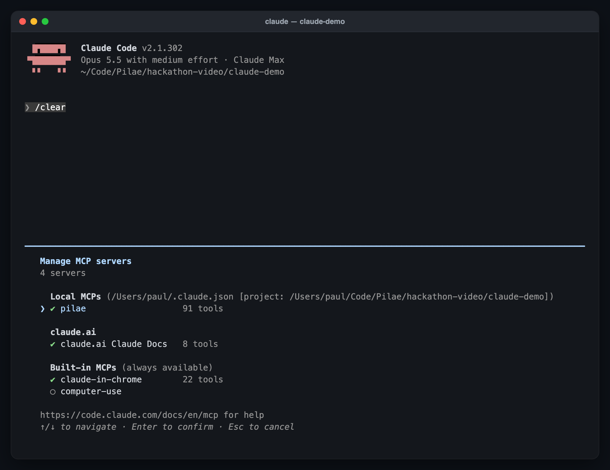
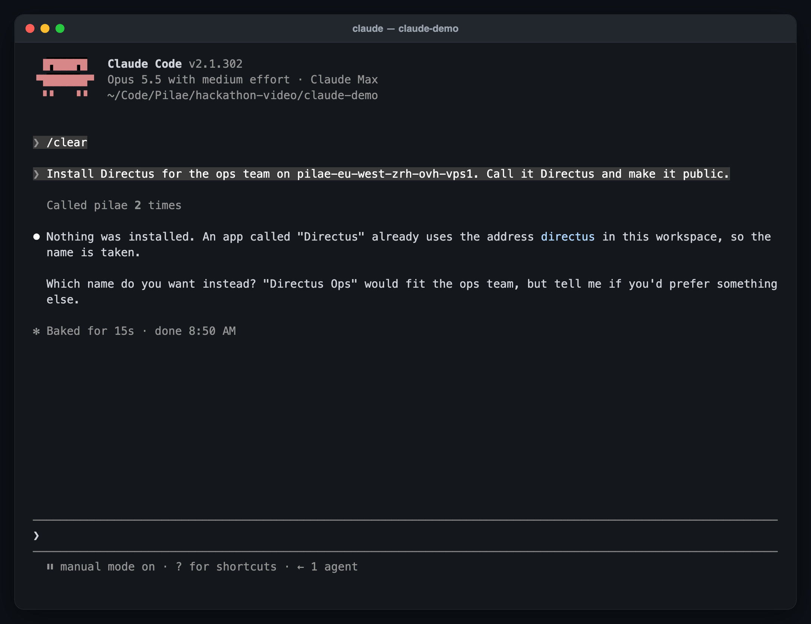
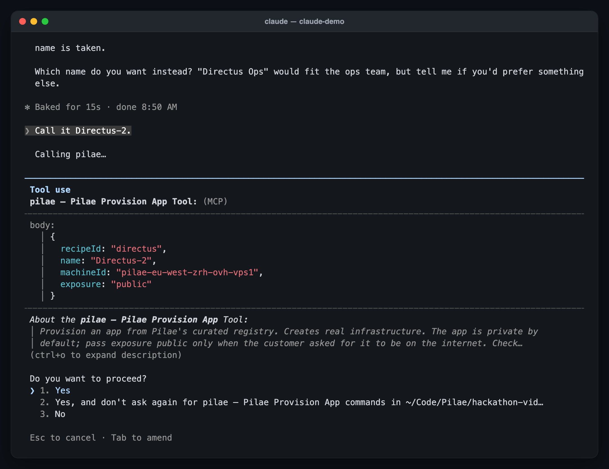
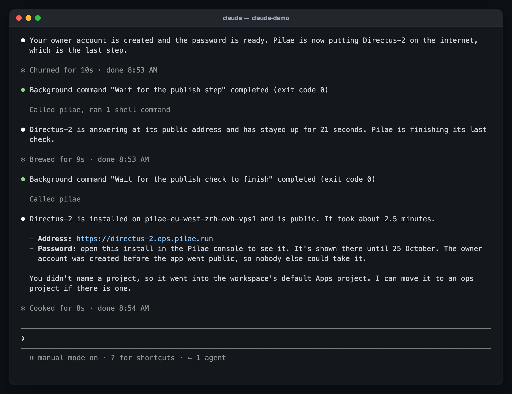
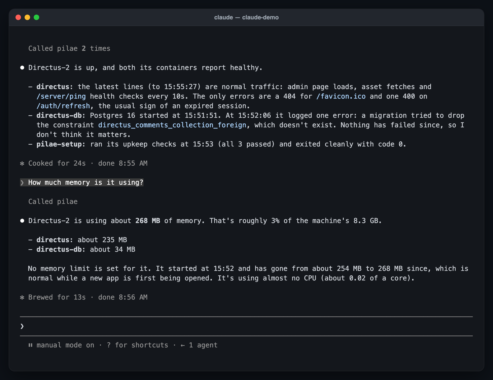
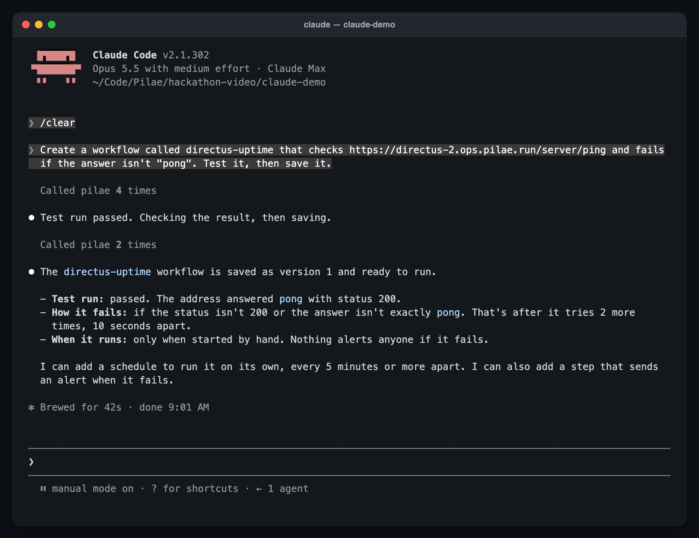

# Agents that host apps, over MCP

**One MCP server that lets Claude Code install, run and maintain open-source apps on your own servers, and that reaches each app's own MCP server through the same endpoint.**

I'm Paul, from Switzerland, and I self-host a lot of open-source apps. Installing them is the easy part. Keeping them running is not: updates, monitoring, backups. And agents don't help much yet: they don't know how your server is set up, so one update can break production.

So I built a kind of neo-cloud: a harness that runs open-source apps on your own servers, with the context and guardrails an agent needs. This weekend, at YC's **Make Something Agents Want** (17–18 October 2026; tracks: Agent-Native Cloud and Best Agent Experience), I built its MCP side.

## Demo

**Video (2 min):** [youtu.be/CYt9kFdpWe8](https://youtu.be/CYt9kFdpWe8)

These screenshots come from a real Claude Code session on staging, Sunday morning: one connection, then an install, maintenance and a workflow, all through the same `pilae` server.

| | |
|---|---|
|  |  |
| **Connected.** One command and a browser sign-in. An owner sees 91 tools. | **A recoverable error.** The name is taken, so the agent asks instead of guessing. |
|  |  |
| **Every change is approved.** The install's exact arguments, before anything runs. | **Installed in 2.5 minutes.** The admin password is shown to a person, never to the agent. |
|  |  |
| **Maintenance.** Logs, memory and redeploys, on the same server. | **Workflows.** An uptime check, tested before it is saved, then scheduled. |

## How an agent experiences it

**One command, no key to paste.** `claude mcp add --transport http pilae <url>/mcp`, then a browser sign-in. The server is an OAuth 2.1 provider that accepts Client ID Metadata Documents, so Claude Code registers itself and no app has to be created by hand.

**The tool list is the truth.** The 94 platform tools are generated from the API's own OpenAPI document, through a hand-curated table that says what each one is: read, write or destructive. 84 are offered and 10 are hidden behind safer hand-written tools ([`TOOLS.md`](TOOLS.md)). Every request builds a fresh server whose tools are the token's scope intersected with the person's role at that moment. An owner sees 91: 84 platform tools and 7 hand-written ones. A member never even sees a delete.

**Three refusals, each one actionable.**
- A missing role names the least role that would do ("It needs the admin role").
- A workspace rule starts with "Not run:", so the agent stops instead of looking for a way round.
- A missing scope is the only one that asks the client to re-authorise. Asking that for a role would send it round a loop that never ends.

**Errors it can recover from.** Preflight answers `NAME_IN_USE` with a free name to try, `MACHINE_REQUIRED` when there are several servers and none was named, and `MACHINE_BUSY` while another install runs. Inputs that must stay out of the model come back as `INPUTS_REQUIRE_CONSOLE`. Every refusal carries a code the agent can act on.

**Secrets never reach the model.** Raw env, compose, log and build-log reads are replaced by tools that redact or return names only. An install claims the app's admin account before the app goes public, locks sign-up, and shows the password once, to a person, in the console.

**Workflows.** The agent reads a guide, writes a workflow, test-runs it, and only then saves and schedules it, asking before each step that changes anything.

**MCP for MCPs.** When an app has its own MCP server, a person connects it once in the console. Its tools then appear on the same `/mcp` endpoint, under the same rules:
- They need the token's `pilae:apps` scope.
- A call that matches a delete the app's recipe declares also needs `pilae:destructive`, and a workspace that hasn't switched destructive actions off.
- The app's descriptions and schemas are untrusted text. They are cleaned and marked as such before a model reads them.
- The credential is opened for one call and never cached.

One agent connection reaches the platform and every connected app.

**Analytics without customer data.** Remote MCP traffic goes to PostHog's MCP analytics. The SDK is handed a stand-in client, so only three events and an allowlist of properties leave: no arguments, results or error text.

## How it fits together

<picture>
  <source media="(prefers-color-scheme: dark)" srcset="docs/how-it-fits-dark.png">
  
</picture>

The diagram's source is [`docs/diagram/how-it-fits.html`](docs/diagram/how-it-fits.html); the comment at its top gives the command that renders both images.

## Built with

- **Cloudflare Workers**, with **Hono** and the official **MCP SDK** (`@modelcontextprotocol/server`), Streamable HTTP
- **D1** through **Drizzle** for state
- **Cloudflare Workflows**: one durable workflow per install, step by step
- **Durable Objects**: each install's live log stream
- **better-auth** as the OAuth 2.1 provider, with Client ID Metadata Documents
- **@posthog/mcp** for MCP analytics
- The apps run in containers on your own servers, reached over a private network

## Try it

```bash
claude mcp add --transport http pilae https://staging-cp-backend.pilae.dev/mcp
# then /mcp in Claude Code, and sign in in the browser
```

Access is by invitation, because the server acts on real machines. Ask for a demo workspace.

## What's in this repo

The platform's codebase is private, so this repo holds **excerpts**: the agent-facing files, copied from the development branch without history. They don't build on their own, because their imports into the rest of the platform aren't included. Comments that mention `PLAN §…` or step ids like `R2` refer to an internal design document.

| File | What it shows |
|---|---|
| [`src/mcp/server.ts`](src/mcp/server.ts) | The remote MCP server: a fresh server per request, `visibleTools`, and app tools registered beside Pilae's own |
| [`src/mcp/scopes.ts`](src/mcp/scopes.ts) | `decideScope` and the three refusals, in words an agent can act on |
| [`src/mcp/instructions.ts`](src/mcp/instructions.ts) | The rules every client gets once, at connect |
| [`src/mcp/analytics.ts`](src/mcp/analytics.ts) | PostHog MCP analytics with a stand-in client and an allowlist |
| [`src/mcp/sanitize.ts`](src/mcp/sanitize.ts) | Cleans an app's tool schemas and descriptions before any model reads them |
| [`src/agent/mcp-tools.ts`](src/agent/mcp-tools.ts) | MCP for MCPs: builds each connected app's tools, opens the credential per call, guards an app's licence caps |
| [`src/agent/app-tool-policy.ts`](src/agent/app-tool-policy.ts) | What may run inside an app without asking, per recipe |
| [`src/agent/tools/curation.ts`](src/agent/tools/curation.ts) | The hand-curated table: every route's class, the hidden routes and why |
| [`scripts/gen-agent-tools.ts`](scripts/gen-agent-tools.ts) | The generator. It fails when the API gains a route nobody decided on |
| [`src/agent/tools/generated.ts`](src/agent/tools/generated.ts) | Its output, trimmed to the first 3 of 94 tools |
| [`TOOLS.md`](TOOLS.md) | All 94 tools: route, least role, class, and the 10 hidden ones |
| [`src/connectors/spec/`](src/connectors/spec) | Any app's OpenAPI 3.0/3.1 spec turned into ranked, fingerprinted operations. A re-index asks a person again only when an operation can do more than they accepted |
| [`src/connectors/operation-pattern.ts`](src/connectors/operation-pattern.ts) | The `"<METHOD> /path"` pattern grammar that connector policies are written in |
| [`docs/`](docs) | The architecture diagram, its source, and the demo screenshots |

## Built during the event

Hacking started on Saturday at 10:30 PT. By Sunday morning these had merged in the platform's private repos:

- **Installs an agent can run end to end:**
  - live build logs;
  - a readiness check from container state;
  - the owner account claimed, sign-up locked, and the password revealed once;
  - install inputs;
  - retry, and remove-and-retry;
  - deployment requests settled by installs;
  - per-app settings;
  - finish and failure emails;
  - NocoDB and Vikunja installable, with sign-up proven closed;
  - the console pages for all of it, including one-click installs from the catalog.
- **MCP and the agent:**
  - tools per role on remote MCP, behind the workspace's switches, with refusals that name the role;
  - server instructions for every client;
  - build-log and container-log tools;
  - single env-var changes;
  - webhooks the agent can create and manage;
  - PostHog MCP analytics on remote traffic, with failure codes.
- **App connectors:**
  - the OpenAPI pipeline in this repo;
  - an operation index built in a durable workflow, with each operation promoted on its own;
  - app operations classified by Pilae's own policy, with an approval card on every write;
  - typed app tools for the console's agent;
  - the private-network transport, and calling app operations through it;
  - a per-workspace switch;
  - a report of whether an installed app can be connected;
  - a simulated sample app to try it all without a machine.

The step-by-step install runner, its live log stream, and the first two app recipes were opened earlier in October and merged during the event.

## Limits, honestly

- **MCP for MCPs isn't in the video.** Connecting Directus 12's own MCP server needs a token made inside Directus, and there wasn't time on Sunday morning. The same path ran end to end with n8n in September, through the console's agent.
- **Typed tools from an app's OpenAPI spec reach the console's agent only so far,** not remote MCP. App connectors are not switched on for customers yet.
- **This is staging.** Production is unchanged by this weekend's work.

## Not in this repo, on purpose

These stay private because they are the security boundary:
- the API routes that enforce roles and tenancy;
- the redaction layer;
- the SSRF guard, and the client that calls an app's MCP server;
- how connection credentials are sealed and stored;
- the private-network gateway;
- the part of the connector pipeline that extracts operations, which encodes the gateway's header rules.

Judges can have access to the full source on request.
